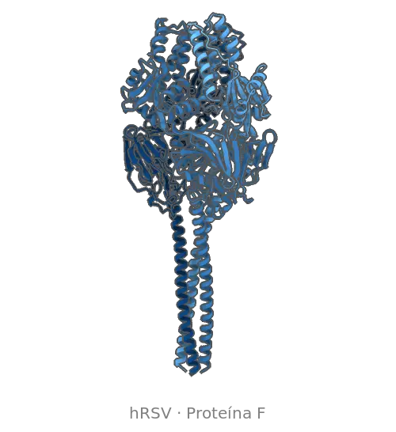

# 🧬 Evelyn Rayani Dias de Araujo

**`Biofísica Computacional · Dinâmica Molecular · Design de Proteínas`**

Sou licenciada em Física pelo IFSP (Campus Votuporanga) e mestre em Biofísica Molecular pela UNESP–IBILCE (São José do Rio Preto/SP). Atualmente sou doutoranda em Ciências Biomoleculares e Farmacológicas na UNESP–IBILCE, onde estudo a **proteína de fusão (F) do Vírus Sincicial Respiratório Humano (hRSV)**. Combino simulações de dinâmica molecular e métodos de design *de novo* de proteínas para identificar intermediários conformacionais da proteína F e desenhar anticorpos e binders contra epítopos estáveis e transientes. O objetivo é entender os mecanismos de fusão viral e de escape imune, contribuindo para estratégias profiláticas mais eficazes contra o hRSV.

    
    
    
    

---

### 🧫 Sistemas e proteínas estudados

  

**Vírus Sincicial Respiratório Humano (hRSV)** 
-0B5394?style=for-the-badge)
-0B5394?style=for-the-badge)

**Metapneumovírus Humano (hMPV)** 

**Vírus Mayaro (MAYV)** 

**Vírus da Encefalite de Saint Louis (SLEV)** 
-00838F?style=for-the-badge)

**SARS-CoV-2** 
-6A1B9A?style=for-the-badge)

---

### 🔬 Áreas de interesse

- Dinâmica conformacional de proteínas virais e mecanismos de fusão de membranas
- Intermediários conformacionais e epítopos transientes
- Design *de novo* de proteínas ligantes (binders)
- Interações proteína–proteína e afinidade molecular
- Energia livre de ligação e estabilidade de complexos biomoleculares

---

### 🧪 Ferramentas científicas

**Dinâmica molecular**: simulações all-atom em solvente explícito e modelos baseados em estrutura (SBM), Cα e all-atom. 

**Predição e modelagem estrutural**: predição de estruturas a partir da sequência e modelagem de complexos proteína–proteína e proteína–binder, usadas como ponto de partida para as simulações e para avaliar os binders desenhados. 

**Design *de novo* de binders**: desenvolvimento de proteínas ligantes, incluindo nanobodies, scFvs e miniproteínas, a partir do desenho de sequências e estruturas capazes de reconhecer e interagir especificamente com um alvo molecular. Envolve a geração e avaliação de candidatos, análise das interfaces de interação e otimização das propriedades estruturais e energéticas para priorizar moléculas promissoras. 

**Energia livre de ligação**: estimativa da variação da energia livre associada à formação do complexo proteína–binder, permitindo comparar candidatos e investigar sua afinidade de ligação com o alvo, para caracterizar a estabilidade e as propriedades energéticas das interações moleculares. 

**Análise estrutural e dinâmica de sistemas biomoleculares**: caracterização do comportamento de proteínas e complexos biomoleculares ao longo de simulações de dinâmica molecular, incluindo avaliação da estabilidade estrutural, flutuações conformacionais, distâncias intermoleculares, contatos, ligações de hidrogênio e propriedades das interfaces de interação. 
-E65100?style=flat-square)

**Visualização molecular e ilustração científica**: visualização e inspeção de estruturas tridimensionais de proteínas e complexos biomoleculares, com elaboração de representações moleculares e figuras científicas para análise e comunicação de resultados. Criação e edição de ilustrações vetoriais para composição, refinamento e padronização de figuras científicas. 

**Computação de alto desempenho (HPC)**: preparação e gerenciamento de tarefas computacionais em ambientes de computação de alto desempenho, incluindo submissão de jobs, configuração de recursos computacionais e automação de fluxos de simulação e análise. 

-37474F?style=flat-square)

---

### 🤖 Linguagens e Tecnologias

 
 

---

### 📚 Produção acadêmica

- **Dissertação de mestrado (2024):** *Desenho racional via estratégias computacionais de ligantes para o sítio de interação fosfoproteína-nucleoproteína no bolso hidrofóbico do domínio N-terminal da proteína nucleocapsídica do hRSV*. UNESP–IBILCE.

**Trabalhos em anais de evento**

- *Genetic Diversity and Adaptation of Mayaro Virus (MAYV) to Different Hosts: Computational Analysis of Mutations in the nsP1 protein*. 49th Annual Meeting of the Brazilian Biophysical Society (SBBf), 2025. [Resumo](https://proceedings.science/p/210479)
- *Design of ligands based on BPdC scaffold for binding to the hydrophobic pocket in the N-terminal domain of nucleoprotein of hRSV*. 48th Annual Meeting of the Brazilian Biophysical Society (SBBf), 2024. [Resumo](https://proceedings.science/p/192282)
- *Rational design via computational strategies of ligands for the phosphoprotein-nucleoprotein interaction site in the hydrophobic pocket of the N-terminal domain of the hRSV nucleocapsid protein*. 47th Annual Meeting of the Brazilian Biophysical Society (SBBf), 2023. [Resumo](https://proceedings.science/p/170232)

**Artigos**

- *O descumprimento da lei de criação dos Institutos Federais e a oferta de cursos na categoria "outros" no IFSP: uma tentativa de elitização do ensino?* Olhar de Professor, 2022. [DOI: 10.5212/OlharProfr.v.25.18220.050](https://doi.org/10.5212/OlharProfr.v.25.18220.050)

Lista completa no [Lattes](http://lattes.cnpq.br/1162707412497645) e no [ORCID](https://orcid.org/0000-0002-4761-788X).
